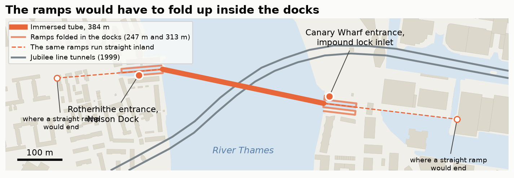
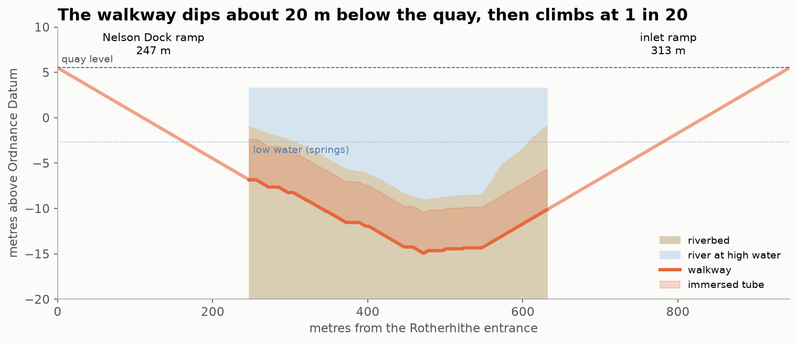
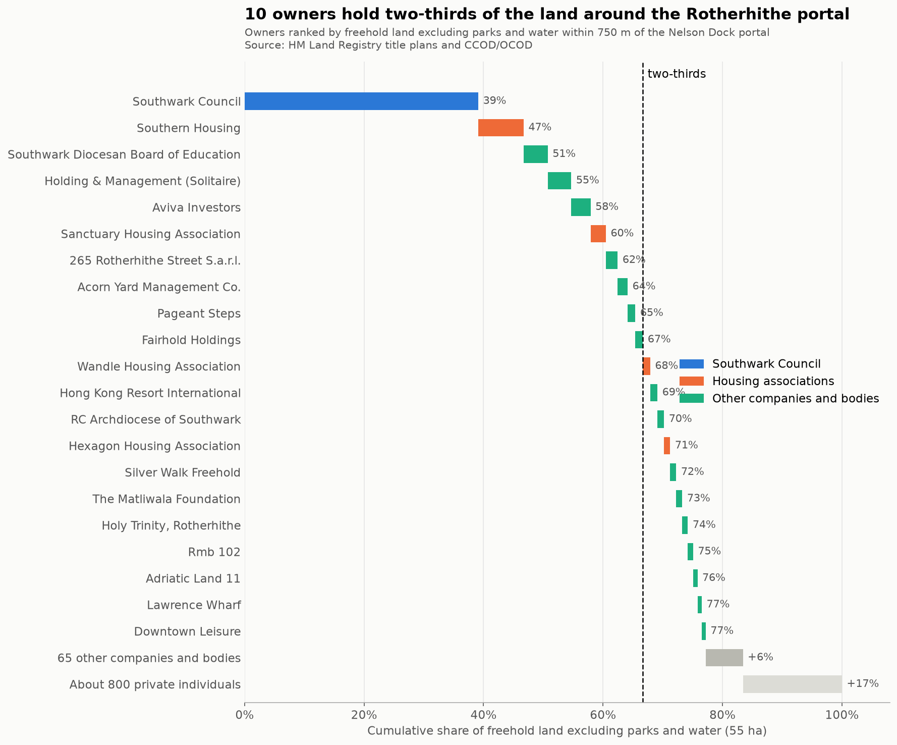
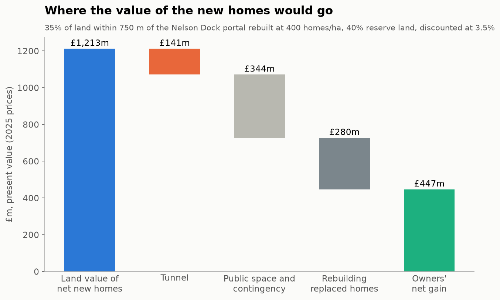

# Introduction

Rotherhithe is a few hundred metres across the river from Canary Wharf, one of the most productive places in Britain, yet it is hard to get to and built at low density.
I think a walking and cycling tunnel would fix both.
It could be paid for by land readjustment, which lets the owners near the tunnel pool and replan their land and sell part of it to cover the cost.

Canary Wharf is one of the great development success stories of recent years.
Even a cynical visitor these days will struggle to write it off as a desolate space filled only by yuppies manipulating abstract financial instruments.
The neighbourhood keeps bustling on weekends.
It is full of bars and restaurants around, and in some cases on, the water.
It has answered the City’s success in winning back financial tenants by diversifying into lab space and residential towers.
Long may its growth continue.

It’s striking how comparably underdeveloped the Rotherhithe side of the river is.
Go for a run from the city centre out to Greenwich and back and you’ll pass several gorgeous old buildings from the area’s days as a working dock.
They are the sort of buildings that are full of commercial offerings further up the river where footfall is greater.
Mostly, though, the buildings of Rotherhithe are from a time when London’s land values were at a low ebb, and are therefore built to a much lower density than you’d see if they were being built today.

Two neighbourhoods.
Extremely close together as the crow flies.
But very different in their urban form.
And it turns out not that easy to travel between.
If you’re actually out running you won’t mind the distance down to Greenwich foot tunnel and back up through the Isle of Dogs.

But if you’re a potential commuter, your options are:

1. A ferry, the Orbit Clipper, runs between Rotherhithe and Canary Wharf piers every 10 minutes at weekday peaks and every 15 minutes at weekends.[^15] It’s a great service.
   However, it’s £4.10 for a ticket, and each boat carries only 150 people, so about 900 people an hour in each direction at best.
2. Travel west for a kilometre to Canada Water and get the Jubilee Line.
   This option also works.
   However, the Jubilee line is already bursting at the seams at peak times.
   When I lived one stop further along near Bermondsey I regularly found myself waiting for several trains to come and go before one arrived with space to spare.
3. Significantly further afield but included for completeness: the Greenwich foot-tunnel is too narrow to allow cyclists to ride.
   They have to walk their bikes through.
   The Rotherhithe road tunnel primarily serves cars.
   It is notoriously toxic and has an extremely narrow pavement.

If we want to densify Rotherhithe and create lots of homes next to the high paying jobs in Canary Wharf the infrastructure will need to improve.

A pedestrian and bicycle tunnel built to similar specifications as the Bergen’s new Fyllingsdaltunellen (a 3.5 metre cycle lane beside a 2.5 metre footway) could comfortably take around 2,000 cyclists an hour in each direction[^12].
This is roughly what the 2 metre cycleway on Blackfriars Bridge already carries in the morning peak[^13].
It could also take 2,500 pedestrians an hour each way before the footway even started to feel busy[^14].
That is around 4,500 people an hour in each direction, about five times what the ferry can manage.

# History 

There is perhaps no section of river in the world with a more storied history of tunnelling.
First attempted by Cornish engineers at the dawn of the 19th century, it was Marc Brunel armed with his tunnelling shield who dug the first tunnel under a navigable river between Rotherhithe and Wapping, completed in 1843.
Converted to carry trains in 1869, the Overground continues to run through it today.

A series of tunnels joined it around the turn of the next century.
The Blackwall tunnel connected Poplar with the north of the Greenwich peninsula.
It was given a twin in the 1960s.
The Rotherhithe road tunnel ran north to Limehouse in 1908.
And the Greenwich and Woolwich foot tunnels in 1902 and 1912 respectively.

In my lifetime, the Jubilee Line was extended east through the newly developing Canary Wharf.
This decade we have added the Silvertown Tunnel, the Thames Tideway “super sewer”, and most recently, much further out along the river, National Grid have bored a 2.2 km tunnel carrying cables between Tilbury and Gravesend, finished in September 2026.[^5]

Sustrans first proposed a walking and cycling bridge between Rotherhithe and Canary Wharf in 2008, and TfL took the scheme on, consulting on it in 2017.
93% of respondents backed a new crossing here.[^10] To let tall ships through, it had to be a lift bridge whose deck rose 60 metres.
By March 2019 its estimated cost had risen to £463m, with a range that could pass £600m, against £350m set aside for it.[^11] That June TfL paused the bridge as unaffordable.

TfL had looked at a tunnel in 2017 too.
It was set aside because, at £325m to £335m, it cost roughly twice as much as the bridge was then expected to.[^6]
By 2019 the bridge was forecast to cost more than the tunnel that had been rejected for being too expensive.
I suggest we return to the tunnel, and to the kind TfL chose: an immersed tube, a concrete box sunk into a trench dredged across the riverbed.
Because it sits just below the riverbed rather than deep beneath it, people can reach it by ramps instead of lifts.
Reporting at the time put TfL’s version between two docks: it would cross about 380 metres of river from the mouth of Nelson Dock on Rotherhithe Street to the inlet of the West India Docks impound lock on Westferry Road, with a ramp inside each dock.[^20]
Unlike Greenwich, where cyclists have to get off and push, it would be wide enough to ride through, with a cycle lane beside the footway.
TfL has described the land by the impound lock as unused apart from lock maintenance.
The tube would pass over the Jubilee line, whose tunnels lie much deeper.

The ramps are the catch.
At its lowest, under the deep channel, the walkway would be about 20 metres below the quay.
It can climb part of the way back up under the shallow foreshore at each side, at the 1 in 20 slope TfL says most UK ramps are built to, but at the river walls it is still 12 to 16 metres down.[^21]
The rest of the climb is a ramp on land: about 250 metres at Rotherhithe and 310 metres at Canary Wharf.
Neither dock is that long, so each ramp would fold back and forth inside its dock, three lengths of Nelson Dock and five of the inlet, spilling onto the quays either side.
Run straight instead, they would end 150 and 240 metres beyond the docks, among the buildings behind.

From entrance to entrance the tunnel would be about 940 metres long.
By bike that takes under four minutes.
On foot it takes about twelve, which is why walkers might still want a lift.

There are a few ways one can build a tunnel under the Thames.

- Hand mining with sprayed concrete is apparently fairly easy in London clay but somewhat risky under water bearing sand.
- You can drive a tunnel boring machine.
  The recently completed Tideway super sewer’s bore was 7 metres wide, roughly what we would need for my proposal.
  The machine is a large fixed cost for a relatively short route.
- You can dredge a trench and drop a concrete tube into it.
  This gives you some more flexibility with the shape of the tunnel and minimises how steep the ramps down to it are because it sits just below the river bed.
  You do have a fair bit of traffic on the river for a while, but this is the design TfL chose in 2017, and the one I cost below.

# Funding

Whichever project or construction method gets selected, this project will not be cheap.
Construction costs have also risen since 2017.
Adjusted for inflation, TfL’s £325m to £335m estimate, which included an allowance for risk and the cost of land, is about £448m in 2025 prices.[^16]
TfL never published what that figure covered.
Pricing the tube item by item, from TfL’s later and much more detailed costing of an immersed tube at Silvertown, gives about £160m, with a range of £110m to £370m.[^17]
Building costs have risen faster than general prices since 2021, so both may be underestimates.
Either way, it will be hard to justify spending such an amount out of general taxation.

We could theoretically fund the tunnel through a tax on the uplift in land value it would create.
Although existing homes would become more valuable, they wouldn’t do so by nearly enough.
My estimate is that the tunnel would add only around £29m to the value of existing homes across the whole area, a fraction of its cost.[^19]
And a tax could only ever capture part of that £29m.

However, much more importantly, the tunnel would enable the land near it to be built on at a far higher density.
And the sale of the net additional properties would raise enough money.
An ideal funding mechanism has to be tied to new development, not just tax the uplift on what is already there.
There is such a mechanism.
It has been used in many places around the world.
It is known as land readjustment.

Land readjustment is a process in which the many owners of irregularly shaped plots of land, by a supermajority vote, agree to pool their property and replan it in a way that results in it being developed.
They receive back property that is of equal or greater value at the end.
Often the land is replanned around a new piece of infrastructure which is funded by the surplus value created by the additional property that is developed.
Germany has used it since Frankfurt’s Lex Adickes of 1902.[^2]
Japan excels at it.
Almost a third of Japan’s urban land has undergone it at one time or another.
The closest precedent to this proposal is Tokyo’s Den’en Toshi line, a railway built on the back of 3,100 hectares of readjustment over 30 years, where the population of the zone rose from 42,000 in 1954 to over 500,000 in 2003.[^3]

England has no land readjustment law today, so this would need legislation.
Under a scheme proposed by the think tank Onward, applied to a tunnel between Canary Wharf and Rotherhithe, the process would work like this:[^4]

- Southwark Council designates a land readjustment area.
  The secretary of state approves it.
- Southwark Council acts as the development agent, or picks a development partner by competitive tender.
  It’s the largest landowner in the area.
- Plots are pooled and the area is replanned at higher density around a new public square at the tunnel entrance.
- Part of the pooled land is sold to fund the tunnel and public spaces.
  Owners get back smaller plots, or new homes/units, that are worth more than what they started with.
  The Valuation Office Agency checks that valuation.
- The scheme goes ahead if a supermajority of owners, holding a supermajority of the land, approve it.

# Support

Could we assemble a supermajority in favour of the proposal?
I believe so.
Within 750 metres of the Nelson Dock entrance, leaving aside parks and water, Southwark Council and seven housing associations own just over half the freehold land.
Just 10 owners between them hold two-thirds.
One of them owns Nelson Dock itself, with the hotel beside it, so the southern entrance would be pooled like everything else.
Private individuals own the freeholds of about a sixth of the land, across roughly 770 titles.
On top of those there are around 2,000 private leases, mostly flats.

Here London’s recent experience is encouraging.
Since 2018, estate regeneration schemes funded by City Hall have needed residents to approve them in a ballot.
The first 13 all passed, with about 80% voting yes on turnouts of around 81%.[^7] By 2023 only one had failed, and it passed when it was rerun.[^8]
Japan’s land readjustment requires two-thirds of affected owners, holding two-thirds of the land.[^4]
That two-thirds is counted against everyone affected, not just those who vote.
Even so, 80% of an 81% turnout is about 65% of everyone eligible, right on the threshold.

Estate ballots were mostly held among social tenants and resident leaseholders of a single landlord, who were offered new homes on the same site.
Many of Rotherhithe’s private leases are likely owned by landlords who don’t live there.
They should be even easier to win over, since readjustment hands them property worth more than what they put in.

Now let’s do some modelling to see whether the property development could fund the tunnel.

# Viability

The tube and its ramps would cost about £159m in 2025 prices, priced item by item from TfL’s Silvertown costing.[^17]
Spent over four years after two years of design and consents, that is £141m in today’s money at the Treasury’s 3.5% discount rate.
The casting dock and the ramps are the biggest items.

What pays for it is the land under the new homes.
The readjustment area, everything within 750 metres of the Nelson Dock entrance on the Rotherhithe side, has 52 hectares that could be built on once parks, water and schools are left out.
Today it has about 63 homes per hectare.
Rebuild a third of it at 400 homes per hectare, the density the government’s land valuers assume across the river in Tower Hamlets,[^18] and you replace about 1,100 homes and add about 6,100.

Not all of a new home’s price is available, because most of it pays for building the home.
Of a typical £610,000 new-build flat in SE16, about £273,000 is the value of the land: the valuers’ £264,000 for high-density land in Southwark, plus a little extra for being near the tunnel.
So the land under 6,100 new homes is worth about £1.7 billion, or £1.2 billion today, since they would be built over 13 years.

Keep back 40% of that land and sell it, and it raises £485m in today’s money.
That covers the £141m tunnel more than three times over, leaving £344m for a public square at the portal, other local improvements and a contingency.

The owners keep the other 60%, worth £730m.
Rebuilding the 1,100 homes that make way costs about £280m, so the owners as a whole end up about £450m better off.
That matters as much as paying for the tunnel, because nothing happens unless two-thirds of them vote for it.

The sums survive slower building and dearer money.
Built at 300 homes a year instead of 500, the reserve still raises £427m.
At a developer’s 7% discount rate instead of the Treasury’s 3.5%, it covers the cost nearly three times over.
Even the most cautious scheme I tried, rebuilding a fifth of the land at Southwark’s own high-density assumption of 260 homes per hectare with a 30% reserve, raises 99% of the cost.
Keep back 40% instead and it covers it with a third to spare.

[^2]: https://worksinprogress.co/issue/how-to-redraw-a-city

[^3]: https://worksinprogress.co/issue/why-japan-has-such-good-railways

[^4]: https://ukonward.com/reports/building-consent

[^5]: https://www.ianvisits.co.uk/articles/new-2-2km-electricity-tunnel-dug-beneath-the-river-thames-93102/

[^6]: TfL’s 2017 Background report, as quoted by Beckett Rankine: https://beckettrankine.com/rotherhithe-ferry/ . Bridge figure also in the London Assembly’s letter of March 2020: https://www.london.gov.uk/who-we-are/what-london-assembly-does/london-assembly-publications/letter-rotherhithe-canary-wharf-crossing

[^7]: https://www.insidehousing.co.uk/news/all-london-regeneration-ballots-passed-since-introduction-65878

[^8]: https://www.newstatesman.com/spotlight/economic-growth/regional-development/2023/03/london-housing-estates-choosing-be-demolished

[^10]: TfL Programmes and Investment Committee, May 2018, section 3.5: https://content.tfl.gov.uk/pic-20180516-item10-rotherhithe-to-canary-wharf.pdf

[^11]: London Assembly letter, March 2020: https://www.london.gov.uk/who-we-are/what-london-assembly-does/london-assembly-publications/letter-rotherhithe-canary-wharf-crossing . GLA response to an information request, November 2021: https://www.london.gov.uk/media/54489/download

[^12]: https://www.tu.no/artikler/na-er-arbeidene-i-gang-med-europas-lengste-sykkeltunnel/460857

[^13]: https://cycling-embassy.org.uk/dictionary/capacity

[^14]: Highway Capacity Manual walkway level of service C, up to 10 pedestrians per minute per foot of width, as tabulated by NYC Planning: https://www.nyc.gov/assets/planning/download/pdf/plans/transportation/td_pedloschaptertwo.pdf

[^15]: Uber Boat by Thames Clippers, weekday RB4 timetable: https://www.thamesclippers.com/plan-your-journey/timetable/weekday-rb4 . Capacity and weekend frequency: https://www.rivieramm.com/news-content-hub/ubers-fully-electric-ferry-starts-services-on-londons-river-thames-87085

[^16]: TfL, The Rotherhithe to Canary Wharf Crossing: Background to Consultation Report (November 2017), Table 6: an immersed tunnel’s capital cost, plus risk allowance, plus land and property, was £325m to £335m in 2016 prices. Archived at https://web.archive.org/web/2018/https://consultations.tfl.gov.uk/rivercrossings/rotherhithe-canarywharf/user_uploads/r2cw---background-to-consultation-report.pdf . Uplifted with the ONS GDP deflator, series YBGB: https://www.ons.gov.uk/economy/grossdomesticproductgdp/timeseries/ybgb/qna . The range is £441m to £454m. TfL also quotes £440m for the tunnel, but that is a different measure: the cost over its 60-year life, including running it, discounted to 2016.

[^17]: Each item of the immersed tube option in TfL’s Silvertown Crossing Study: Tunnel Engineering (Mott MacDonald, 2012, Tables 17.1 to 17.3) is scaled to the size of this tube, keeping the costs that don’t shrink with size (the casting dock, cofferdams, floating out each element, design and surveys), with the study’s own allowances for preliminaries, design, supervision and risk: https://content.tfl.gov.uk/st-silvertown-crossing-study-tunnel-engineering.pdf . The ramps are priced from the same study’s unit rates. For comparison, a bored tunnel with lifts on a shorter line from Durand’s Wharf would cost £277m to £594m, from HS2 Ltd’s Guide to Tunnelling Costs and the Infrastructure and Projects Authority and British Tunnelling Society’s tunnel benchmarks, with optimism bias from the Green Book. Each estimate is worked through step by step in `nbs/05_cost.ipynb`.

[^18]: MHCLG, Land value estimates for policy appraisal 2023, residential land at the “high density” assumption for each local authority.

[^19]: From around 21,000 sales since 2018 in Rotherhithe, Deptford, the Isle of Dogs and Wapping. Allowing for the type of home, the year of sale and distance to the river, a 10% shorter journey to Canary Wharf goes with prices about 3% higher. On foot or by public transport the tunnel cuts the trip from the Nelson Dock entrance from 33 minutes to 20, but walking the ramps is slow, so only about 1,000 households would see their home’s value rise by more than 1%. Counting cycling, the gain would be far larger. The calculations are in `nbs/04_uplift.ipynb`.

[^20]: IanVisits, “Pedestrian and cyclist crossing planned for the Thames”, 8 November 2017. TfL’s own consultation said only that a tunnel “could be relatively flexible in location” and would be reached “by lifts or potentially by ramps”: Factsheet 2, archived at https://web.archive.org/web/2018/https://consultations.tfl.gov.uk/rivercrossings/rotherhithe-canarywharf/user_uploads/r2cw---factsheet-2---crossing-options.pdf

[^21]: TfL, Background to Consultation Report (November 2017), paragraph 4.22, which also warns that ramps this long may need gentler slopes and landings to be comfortable. The tube’s depth comes from the riverbed along the crossing on the Port of London Authority’s chart 319, Lower Pool to Limehouse Reach (deepest about 5.6 m below chart datum, which is 3.35 m below Ordnance Datum): https://assets.pla.co.uk/hydrographic-services/main-survey-charts/319msc.pdf , and the Environment Agency’s flood defence records, which put the river walls at both ends at 5.2 m to 5.8 m above Ordnance Datum. The walkway sits 6 m below the riverbed (1.5 m of cover, a 1 m roof and 3.5 m of headroom) and climbs at no more than 1 in 20. The profile is worked out in `nbs/00_config.ipynb`.
