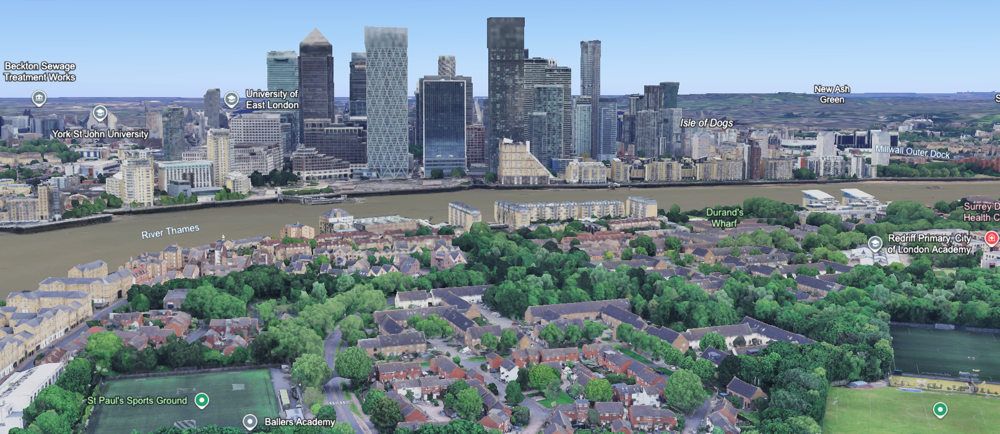
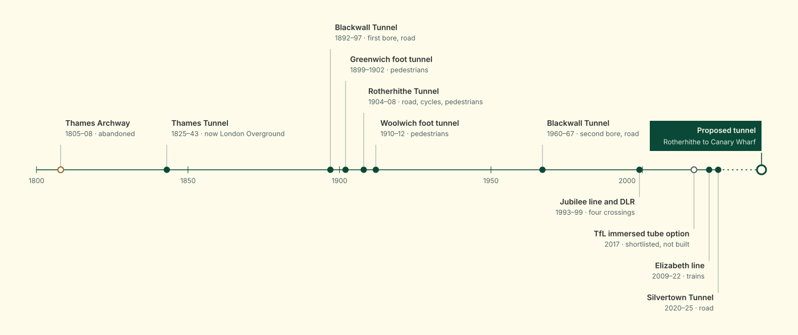
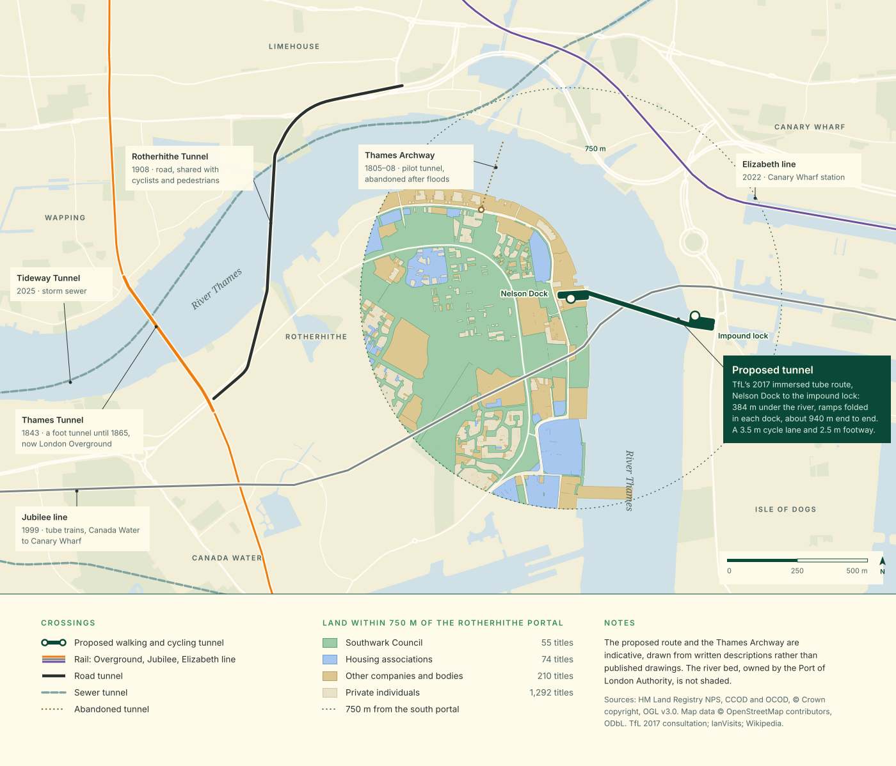
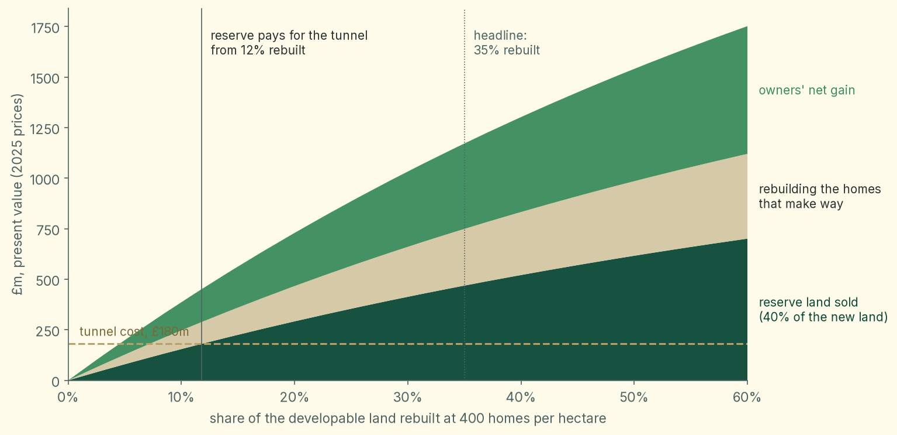

# Introduction

Canary Wharf is one of the great development success stories of recent years.
Even a cynical visitor these days will struggle to write it off as a desolate space filled only by yuppies manipulating abstract financial instruments.
The neighbourhood keeps bustling on weekends.
It is full of bars and restaurants around, and in some cases on, the water.
It has responded to the City’s success in winning back financial tenants by diversifying into lab space and residential towers.
Long may its growth continue.

It’s striking how comparably underdeveloped the Rotherhithe side of the river is.
Go for a run from the city centre out to Greenwich and back and you’ll pass several gorgeous old buildings from the area’s days as a working dock.
They are the sort of buildings that are full of commercial offerings further up the river where footfall is greater.
Mostly though, the buildings of Rotherhithe are from a time when London’s land values were at a low ebb, and are built to a much lower density than you’d see if they were being built today.

We could create a huge amount of value by densifying Rotherhithe.
But although it is tantalisingly close to Canary Wharf as the crow flies, this section of river is relatively inconvenient to commute across.
Your options are:

1. A ferry, the Orbit Clipper, runs every 10 minutes at weekday peaks and every 15 minutes at weekends.[^1] It’s a good service but it costs £4.10 for a ticket, and each boat carries only 150 people, so about 900 people an hour in each direction at best.
2. Travel in the opposite direction for a kilometre and get the Jubilee Line from Canada Water.
   The Jubilee line is already bursting at the seams at peak times.
   When I lived one stop further along near Bermondsey I often found myself waiting for several trains to come and go before one arrived with space to spare.
3. The next nearest crossings are significantly further away.
   The Greenwich foot-tunnel is too narrow to allow cyclists and makes them walk their bikes through.
   The Rotherhithe road tunnel primarily serves cars.
   It is notoriously toxic and has an extremely narrow pavement.

If we want to densify Rotherhithe and create lots of homes next to the high paying jobs in Canary Wharf the infrastructure will need to improve.

A pedestrian and bicycle tunnel built to similar specifications as Bergen’s new Fyllingsdaltunellen (a 3.5 metre cycle lane beside a 2.5 metre footway) could comfortably take around 2,000 cyclists an hour in each direction[^2].
This is roughly what the 2 metre cycleway on Blackfriars Bridge already carries in the morning peak[^3].
It could also take 2,500 pedestrians an hour each way before the footway even started to feel busy[^4].
That is around 4,500 people an hour in each direction, about five times what the ferry can manage.

# History 

There is perhaps no section of river in the world with a more storied history of tunnelling.
First attempted by Cornish engineers at the dawn of the 19th century, it was Marc Brunel armed with his tunnelling shield who dug the first tunnel under a navigable river between Rotherhithe and Wapping, completed in 1843.
Converted to carry trains in 1869, the Overground continues to run through it today.

A series of tunnels joined it around the turn of the next century.
The Blackwall tunnel connected Poplar with the north of the Greenwich peninsula.
It was given a twin in the 1960s.
The Rotherhithe road tunnel ran north to Limehouse in 1908.
And the Greenwich and Woolwich foot tunnels in 1902 and 1912 respectively.

In my lifetime, the Jubilee Line was extended east through the newly developing Canary Wharf.
This decade we have added the Silvertown Tunnel, the Thames Tideway “super sewer”, and most recently, much further out along the river, National Grid have bored a 2.2 km tunnel carrying cables between Tilbury and Gravesend, finished in September 2026.[^5]

Sustrans proposed a walking and cycling bridge between Rotherhithe and Canary Wharf in 2008.
TfL consulted on it in 2017.
93% of respondents backed a new crossing.[^6] To let tall ships through, it had to be a lift bridge whose deck rose 60 metres.
By March 2019 its estimated cost had risen to £463m, with a range that could pass £600m, against £350m set aside for it.[^7] That June TfL paused the bridge as unaffordable.

TfL also consulted on a tunnel in 2017.
It was set aside as, at about £330m, it cost roughly twice as much as the bridge was then expected to.[^8] Given the extra constraints and costs a bridge would have to overcome, I believe a tunnel will be will be easier to deliver.

# Design 

There are a few ways one can build a tunnel under the Thames.

- Hand mining with sprayed concrete is apparently fairly easy in London clay but somewhat risky under water bearing sand.
- Using a tunnel boring machine.
  The recently completed Tideway super sewer’s bore was 7 metres wide, roughly what we would need.
  But a TBM is a large fixed cost for a relatively short route.
- Dredging a trench and lowering a concrete tube into it.
  This provides some more flexibility with the shape of the tunnel and minimises how steep the ramps down to it are because it sits just below the river bed.
  There is a fair bit of traffic on the river for a while.
  This is the design TfL considered in 2017, and the one whose costs I estimate below.

The tunnel would cross about 380 metres of river from the mouth of Nelson Dock on Rotherhithe Street to the inlet of the West India Docks impound lock on Westferry Road, with a ramp inside each dock.[^9] Unlike Greenwich, where cyclists have to get off and push, it would be wide enough to cycle through, with a bike lane beside the footway.

It would pass over the Jubilee line, whose tunnels lie much deeper.
At its lowest, under the deep channel, the walkway would be about 20 metres below the quay.
TfL say most British ramps are built to a gradient of 1 in 20.
This would leave the tunnel 12 to 16 metres below the top of the river walls.[^10] This height would be covered by a stairs for able bodied pedestrians and by a ramp for cyclists, pushchairs, wheelchairs, etc. The total length of the ramp would be 250 metres at Rotherhithe and 310 metres at Canary Wharf.
Neither dock is that long, so each ramp would fold back and forth inside its dock, three lengths of Nelson Dock and five of the inlet, spilling onto the quays either side.

# Funding

Whichever project or construction method gets selected, this project will not be cheap.
Construction costs have also risen since 2017.
Adjusted for inflation, TfL’s £325m to £335m estimate, which included an allowance for risk and the cost of land, is about £448m in 2025 prices.[^11]
TfL never published what that figure covered.
Pricing the tube item by item, from TfL’s later and much more detailed costing of an immersed tube at Silvertown, gives about £200m, with a range of £130m to £370m.[^12]
Building costs have risen faster than general prices since 2021, so both may be underestimates.
Either way, it will be hard to justify spending such an amount out of general taxation.

We could theoretically fund the tunnel through a tax on the uplift in land value it would create.
Although existing homes would become more valuable, they wouldn’t do so by nearly enough.
My estimate is that the tunnel would add only around £29m to the value of existing homes across the whole area, a fraction of its cost.[^13]
And a tax could only ever capture part of that £29m.

However, much more importantly, the tunnel would enable the land near it to be built on at a far higher density.
And the sale of the net additional properties would raise enough money.
An ideal funding mechanism has to be tied to new development, not just tax the uplift on what is already there.
There is such a mechanism.
It has been used in many places around the world.
It is known as land readjustment.

Land readjustment is a process in which the many owners of irregularly shaped plots of land, by a supermajority vote, agree to pool their property and replan it in a way that results in it being developed.
They receive back property that is of equal or greater value at the end.
Often the land is replanned around a new piece of infrastructure which is funded by the surplus value created by the additional property that is developed.
Germany has used it since Frankfurt’s Lex Adickes of 1902.[^14]
Japan excels at it.
Almost a third of Japan’s urban land has undergone it at one time or another.
The closest precedent to this proposal is Tokyo’s Den’en Toshi line, a railway built on the back of 3,100 hectares of readjustment over 30 years, where the population of the zone rose from 42,000 in 1954 to over 500,000 in 2003.[^15]

England has no land readjustment law today, so this would need legislation.
Under a scheme proposed by the think tank Onward, applied to a tunnel between Canary Wharf and Rotherhithe, the process would work like this:[^16]

- Southwark Council designates a land readjustment area.
  The secretary of state approves it.
- Southwark Council acts as the development agent, or picks a development partner by competitive tender.
  It’s the largest landowner in the area.
- Plots are pooled and the area is replanned at higher density around a new public square at the tunnel entrance.
- Part of the pooled land is sold to fund the tunnel and public spaces.
  Owners get back smaller plots, or new homes/units, that are worth more than what they started with.
  The Valuation Office Agency checks that valuation.
- The scheme goes ahead if a supermajority of owners, holding a supermajority of the land, approve it.

# Support

Could we assemble a supermajority in favour of the proposal?
I believe so.
Within 750 metres of the Nelson Dock entrance, leaving aside parks and water, Southwark Council and seven housing associations own just over half the freehold land.
Just 10 owners between them hold two-thirds.
One of them owns Nelson Dock itself, with the hotel beside it, so the southern entrance would be pooled like everything else.
Private individuals own the freeholds of about a sixth of the land, across roughly 770 titles.
On top of those there are around 2,000 private leases, mostly flats.

Here London’s recent experience is encouraging.
Since 2018, estate regeneration schemes funded by City Hall have needed residents to approve them in a ballot.
The first 13 all passed, with about 80% voting yes on turnouts of around 81%.[^17] By 2023 only one had failed, and it passed when it was rerun.[^18]
Japan’s land readjustment requires two-thirds of affected owners, holding two-thirds of the land.[^16]
That two-thirds is counted against everyone affected, not just those who vote.
Even so, 80% of an 81% turnout is about 65% of everyone eligible, right on the threshold.

Estate ballots were mostly held among social tenants and resident leaseholders of a single landlord, who were offered new homes on the same site.
Many of Rotherhithe’s private leases are likely owned by landlords who don’t live there.
They should be even easier to win over, since readjustment hands them property worth more than what they put in.

# Viability

The tunnel and its ramps would cost about £203m in 2025 prices, based on similar items in TfL’s Silvertown tunnel costing.[^12] Spent over four years after two years of design and consents, its present value is £180m at the Treasury’s 3.5% discount rate.
The casting dock and the ramps are the biggest items.

The readjustment area, everything within 750 metres of the Nelson Dock entrance on the Rotherhithe side, has 52 hectares that could be built on once parks, water and schools are excluded.
Today it has about 63 homes per hectare.
Rebuilding a third of it at 400 homes per hectare (the same density as Tower Hamlets),[^19] would mean replacing 1,100 homes and adding 6,100.

Of a typical £610,000 new-build flat in SE16, about £264,000 comes from the value of the land, according to the government’s land value estimates for high-density housing in Southwark.[^19]
Being near the tunnel would probably add to that, but I have left any such premium out, so these figures are conservative.
So the land under 6,100 new homes is worth about £1.6 billion, or £1.2 billion in present value, since they would be built over 13 years.

Selling 40% of that land would raise £469m in present value.
That covers the £180m tunnel more than two and a half times over, leaving £289m for a public square at the portal, other local improvements and a contingency.
In fact the reserve would pay for the tunnel once just 12% of the land was rebuilt at that density, or 20% at 260 homes per hectare.

The existing owners would keep the other 60%, worth £700m.
Rebuilding their existing 1,100 homes would cost about £280m, so the owners as a whole end up about £420m better off.

If only 300 homes a year were built instead of 500, the reserve would still raise £412m.
At a developer’s 7% discount rate instead of the Treasury’s 3.5%, that still covers the cost more than twice over.
Even the most cautious scheme I modelled, rebuilding a fifth of the land at Southwark’s own high-density assumption of 260 homes per hectare with a 30% reserve, raises 75% of the cost.
Keeping back 40% gets it to 99%.

# Conclusion

There is nothing more powerful for improving living standards than economic growth compounding upon itself.
By embracing building thousands of homes in Rotherhithe we create the means to fund a transformative new piece of infrastructure.
The waterfront between Bermondsey and Greenwich is currently a quiet windswept part of the city.
I hope to see it come to life in the future as new residents and make their lives there with access to wherever their ambition leads them.

[^1]: https://www.thamesclippers.com/plan-your-journey/timetable/weekday-rb4 https://www.rivieramm.com/news-content-hub/ubers-fully-electric-ferry-starts-services-on-londons-river-thames-87085

[^2]: https://www.tu.no/artikler/na-er-arbeidene-i-gang-med-europas-lengste-sykkeltunnel/460857

[^3]: https://cycling-embassy.org.uk/dictionary/capacity

[^4]: https://www.nyc.gov/assets/planning/download/pdf/plans/transportation/td_pedloschaptertwo.pdf

[^5]: https://www.ianvisits.co.uk/articles/new-2-2km-electricity-tunnel-dug-beneath-the-river-thames-93102/

[^6]: https://content.tfl.gov.uk/pic-20180516-item10-rotherhithe-to-canary-wharf.pdf

[^7]: https://www.london.gov.uk/who-we-are/what-london-assembly-does/london-assembly-publications/letter-rotherhithe-canary-wharf-crossing https://www.london.gov.uk/media/54489/download

[^8]: https://beckettrankine.com/rotherhithe-ferry/ https://www.london.gov.uk/who-we-are/what-london-assembly-does/london-assembly-publications/letter-rotherhithe-canary-wharf-crossing

[^9]: https://www.ianvisits.co.uk/blog/2017/11/08/pedestrian-and-cyclist-bridge-planned-for-the-thames/ https://web.archive.org/web/2018/https://consultations.tfl.gov.uk/rivercrossings/rotherhithe-canarywharf/user_uploads/r2cw---factsheet-2---crossing-options.pdf

[^10]: https://web.archive.org/web/2018/https://consultations.tfl.gov.uk/rivercrossings/rotherhithe-canarywharf/user_uploads/r2cw---background-to-consultation-report.pdf https://assets.pla.co.uk/hydrographic-services/main-survey-charts/319msc.pdf https://environment.data.gov.uk/asset-management/downloads/spatial-flood-defences.pdf https://github.com/HenryDashwood/rotherhithe-to-canary-wharf-tunnel/blob/main/nbs/00_config.ipynb

[^11]: https://web.archive.org/web/2018/https://consultations.tfl.gov.uk/rivercrossings/rotherhithe-canarywharf/user_uploads/r2cw---background-to-consultation-report.pdf https://www.ons.gov.uk/economy/grossdomesticproductgdp/timeseries/ybgb/qna

[^12]: https://content.tfl.gov.uk/st-silvertown-crossing-study-tunnel-engineering.pdf https://github.com/HenryDashwood/rotherhithe-to-canary-wharf-tunnel/blob/main/nbs/05_cost.ipynb

[^13]: https://github.com/HenryDashwood/rotherhithe-to-canary-wharf-tunnel/blob/main/nbs/04_uplift.ipynb

[^14]: https://worksinprogress.co/issue/how-to-redraw-a-city

[^15]: https://worksinprogress.co/issue/why-japan-has-such-good-railways

[^16]: https://ukonward.com/reports/building-consent

[^17]: https://www.insidehousing.co.uk/news/all-london-regeneration-ballots-passed-since-introduction-65878

[^18]: https://www.newstatesman.com/spotlight/economic-growth/regional-development/2023/03/london-housing-estates-choosing-be-demolished

[^19]: https://www.gov.uk/government/publications/land-value-estimates-for-policy-appraisal-2023
